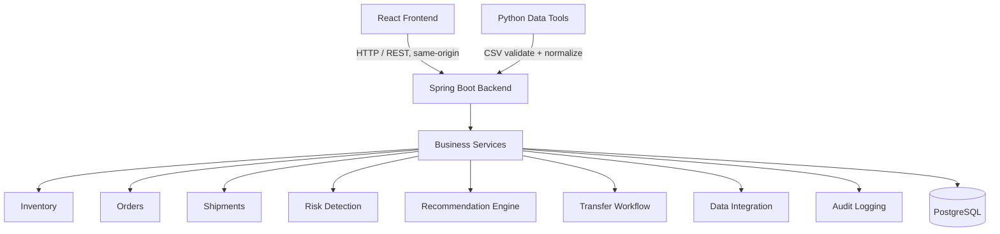

# SupplyChainOS — Intelligent Supply Chain Operations & Decision Intelligence Platform

> **Status: Phase 1 complete — foundation only.** Backend boots, Flyway schema exists,
> session auth works, frontend shell talks to real Postgres-backed APIs.
> Modules marked “Phase 2–6” are placeholders, not finished features. No fake API responses.

Fictional demo company: **Northstar Commerce** (Seattle · Chicago · Atlanta).
All demonstration data is **synthetic** and labelled as such. No real customers, revenue,
or production usage is claimed anywhere in this repo.

## What it does (when complete)

Transform fragmented operational data into actionable supply chain decisions:

- Which products are at risk of running out?
- Which warehouses have excess inventory?
- Which shipments are delayed?
- Where should inventory be transferred, at what cost?
- What changed after a decision was executed?

## Tech stack

| Layer | Technology |
|---|---|
| Frontend | React 18, TypeScript, Vite, Tailwind CSS, shadcn/ui-style components, TanStack Query, Recharts, React Router |
| Backend | Java 21, Spring Boot 3, Spring Web, Spring Data JPA, Spring Security, Bean Validation, Maven |
| Database | PostgreSQL 16, Flyway |
| Data tools | Python 3 + Pandas (Phase 2) |
| Testing | JUnit 5, Mockito, Spring Boot Test, Testcontainers, Vitest, Playwright (later phases) |
| DevOps | Docker, Docker Compose, GitHub Actions |

## Architecture (modular monolith)



Why a modular monolith (not microservices): one deployable, one database, one
transaction boundary for inventory operations. Microservices would split the
transfer-approval transaction across services with no benefit at this scale.
See `docs/decisions/ADR-001-modular-monolith.md`.

Full docs: `docs/architecture/ARCHITECTURE.md`, `docs/database/SCHEMA.md`,
`docs/api/API.md`, `docs/testing/TESTING.md`, `docs/decisions/`.

## Quick start (Phase 1)

Prerequisites: Docker + Docker Compose, **or** Java 21 + Maven + Node 20 + a local PostgreSQL 16.

```bash
cp .env.example .env        # fill in a local-only DB password
docker compose up --build   # db :5432, backend :8080, frontend :5173
```

Then open http://localhost:5173 and sign in with the **dev-only** seed admin:

- Email: `admin@northstar.demo`
- Password: the value you set for `SEED_ADMIN_PASSWORD` in your `.env` (no default is committed; seeding is skipped when unset)

> The seed admin is created only on the `dev`/`docker` Spring profiles when the
> users table is empty. Never use it in a shared/production environment.

### Without Docker

```bash
# 1. Start Postgres 16 locally and create DB `supplychainos`
# 2. Backend (Flyway runs migrations automatically on boot)
cd backend && mvn spring-boot:run
# 3. Frontend (Vite proxies /api -> localhost:8080)
cd frontend && npm install && npm run dev
```

### Verify Phase 1

```bash
curl http://localhost:8080/api/health
# {"success":true,"data":{"status":"UP","service":"supplychainos-backend"},...}

# Unauthenticated request must be rejected:
curl -i http://localhost:8080/api/warehouses   # -> 401

# Authenticated (after login, cookie + CSRF handled by the frontend):
curl http://localhost:8080/api/warehouses      # -> 3 seeded warehouses (SEA/CHI/ATL)
```

## Testing

```bash
cd backend && mvn test          # Phase 1: SmokeTest (health + auth enforcement, H2)
cd frontend && npm test         # Vitest: format helper
```

Testcontainers/Postgres integration tests land with the modules they cover
(Phases 2–5) — Phase 1 does **not** claim them.

## Project structure

```
supplychain-os/
├── frontend/          # React + TS + Vite + Tailwind
├── backend/           # Spring Boot 3 (controller/service/repository/entity/dto/security/exception/config)
├── data-tools/        # Python CSV tools (Phase 2)
├── sample-data/       # Synthetic CSVs (Phase 2)
├── docs/              # architecture / api / database / testing / decisions
├── .github/workflows/ # CI
├── docker-compose.yml
├── .env.example
└── README.md
```

## Roadmap

- **Phase 1 (done):** architecture, repo, DB schema, backend + frontend foundation, auth, CI.
- **Phase 2:** data models, synthetic data generation, CSV ingestion + validation.
- **Phase 3:** core APIs, dashboard, inventory, orders, shipments.
- **Phase 4:** risk detection + transfer recommendation engine.
- **Phase 5:** transfer approval workflow, concurrency safety, audit logging.
- **Phase 6:** full testing, Docker, CI/CD, docs, demo + interview prep.

## Engineering challenges (preview)

Inventory consistency (transactions + optimistic locking + `SELECT FOR UPDATE`
on approval), import idempotency (source-system natural keys + source hash),
and explainable deterministic recommendations (no LLM in the decision path).
Details in `docs/architecture/`.

## License

MIT — see `LICENSE`.
