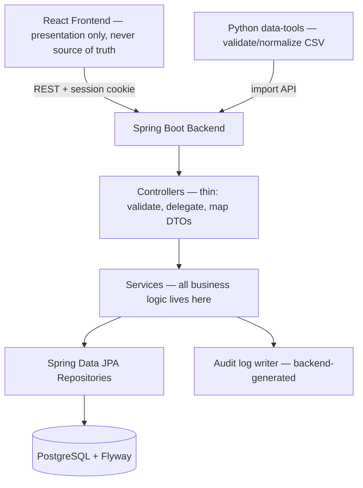

# Architecture

## Product goal

Transform fragmented operational data into actionable supply chain decisions
for Northstar Commerce (fictional, synthetic data).

## High-level design

Modular monolith. One Spring Boot deployable, one PostgreSQL database, one
transaction boundary for inventory operations. Modules communicate via
in-process service calls — not HTTP, not queues — until a concrete scaling
need justifies otherwise.

## Module map (spec §5) → phase

| Module | Phase | Status |
|---|---|---|
| A Dashboard | 3 | Placeholder page; `/api/dashboard/overview` (real counts) exists in Phase 1 |
| B Inventory | 3 | Schema + entity exist; list/filter UI in Phase 3 |
| C Orders | 3 | Schema only |
| D Shipments | 3 | Schema only |
| E Data Integration | 2 | Schema only |
| F Risk Detection | 4 | Schema only |
| G Recommendation Engine | 4 | Schema (routes + recommendations) only |
| H Transfer Workflow | 5 | Schema only |
| I Alerts + Audit | 5 | Schema only |

## Key invariants

1. **Frontend is never the source of truth for inventory.** Available quantity
   is computed on the backend (`on_hand - reserved`) and enforced by DB
   check constraints (`reserved <= on_hand`, both `>= 0`).
2. **All business operations run on the backend**, inside transactions.
3. **Recommendations never mutate inventory.** They require approval; approval
   revalidates source stock and reserves transactionally (Phase 5).
4. **Imports are idempotent.** Source-system natural keys
   (`(source_system, source_*_id)`) + a source-file hash guard re-imports (Phase 2).
5. **No fake responses.** Every visible control either works or is an explicit
   placeholder that says which phase ships it.

## Concurrency strategy (summary)

- `inventory.version` — optimistic locking (`@Version`) for ordinary updates.
- Transfer approval (Phase 5) — pessimistic `SELECT ... FOR UPDATE` on the
  source inventory rows inside one transaction, so two concurrent approvals
  cannot over-reserve the same stock. Concurrent-approval test (Scenario D)
  is a Phase 5 acceptance test.
- Idempotency keys / conditional transitions prevent double-execution of a
  state transition on retry.

## Security

- Session-based auth, HttpOnly session cookie (`SameSite=Lax`, `Secure` in prod).
- CSRF: `XSRF-TOKEN` cookie (readable by JS) + `X-XSRF-TOKEN` header on mutations.
- Passwords: BCrypt(12). No secrets in frontend code or committed files.
- Backend enforces roles (ADMIN / OPERATIONS_MANAGER / ANALYST) on endpoints
  with `@PreAuthorize`; frontend navigation is UX only, never authorization.
- Global exception handler returns a consistent envelope and never leaks
  stack traces or DB internals.

## Observability

- Structured logs (SLF4J), `/actuator/health` (no details exposed).
- Audit logs are backend-generated events, not frontend notifications (Phase 5).

## What is deliberately NOT in the MVP

Redis, message queues, AWS, LLM integration. Each would be added only when
it solves a concrete problem; the recommendation engine is deterministic
and documented as a transparent rule-based model, not ML.
