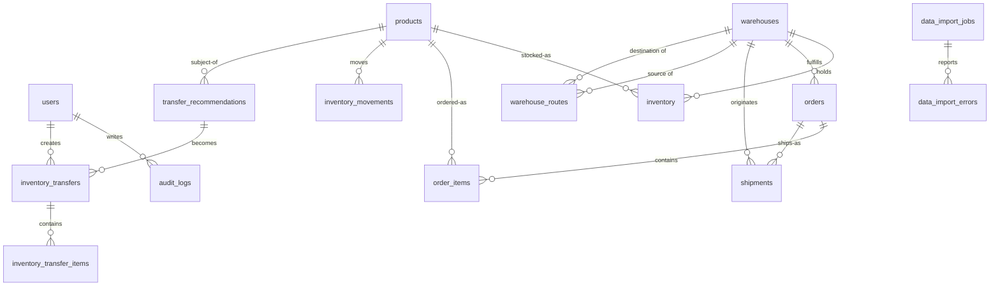

# Database design

PostgreSQL 16. Migrations under `backend/src/main/resources/db/migration/`.

## Diagram

## Tables (16)

| Table | Purpose | Notable constraints |
|---|---|---|
| users | Operators | email UNIQUE, role CHECK |
| warehouses | 3 Northstar DCs | code UNIQUE |
| products | Catalogue | sku UNIQUE, price >= 0 |
| inventory | Stock per (warehouse, product) | UNIQUE(warehouse, product); on_hand >= 0; reserved >= 0; reserved <= on_hand; `version` for optimistic locking |
| orders | Customer orders | order_number UNIQUE; UNIQUE(source_system, source_order_id) for import idempotency |
| order_items | Order lines | quantity > 0 |
| shipments | Shipments | shipment_number UNIQUE; UNIQUE(source_system, source_shipment_id) |
| inventory_movements | Append-only stock ledger | quantity_change <> 0 |
| warehouse_routes | Lane cost / transit time | UNIQUE(source, dest); source <> dest |
| data_import_jobs | Import metadata | source_hash for duplicate-file detection |
| data_import_errors | Per-row validation errors | FK -> jobs, ON DELETE CASCADE |
| alerts | Operational alerts | severity CHECK, status CHECK |
| transfer_recommendations | Engine output (DRAFT/…) | source <> dest; quantity > 0 |
| inventory_transfers | Approved transfers (state machine) | transfer_number UNIQUE; `version` |
| inventory_transfer_items | Transfer lines | UNIQUE(transfer, product) |
| audit_logs | Backend-generated audit trail | indexed by (entity, time) and (user, time) |

## Conventions

- PKs: `UUID` (`gen_random_uuid()`). Money: `NUMERIC(12,2)`.
- Timestamps: `TIMESTAMPTZ`, UTC, `created_at`/`updated_at`.
- Indexes on every FK used in a list/filter query plus composite
  `(warehouse_id, status)` / `(status, severity, created_at)` for the hot paths.
- `ddl-auto: validate` in the app — Flyway owns the schema, Hibernate never
  auto-creates tables. Tests use `create-drop` on H2 only.

## Inventory consistency

Available = `quantity_on_hand - reserved_quantity`, computed (never stored).
The DB check constraints are the last line of defence; service-layer
validation + transactions are the first. Negative inventory is impossible
under every supported workflow (Phase 5 proves it with a concurrent-approval test).
